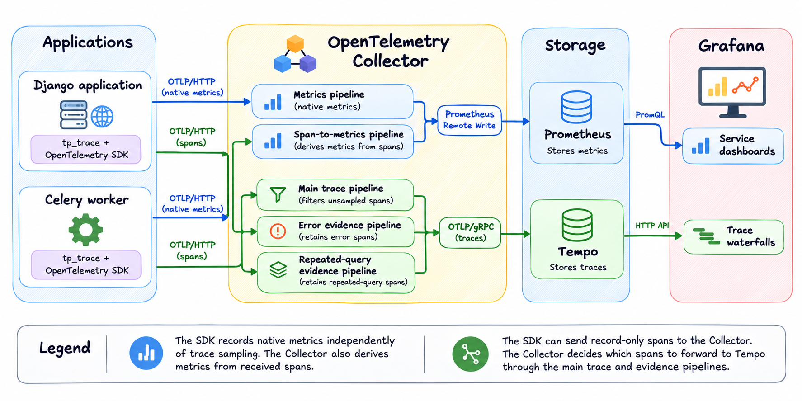

# tp_trace Architecture

Read this when working on the SDK or telemetry pipeline. [Observability Basics](01-basics.md)
covers the terms used here.

`tp_trace` is a production Python APM library built on OpenTelemetry. It instruments your application to generate traces and metrics, routes them through an OpenTelemetry Collector, stores them in Tempo and Prometheus, and visualizes them in Grafana.

---

## Architecture Flow

---

## End-to-End Lifecycle: From Request to Grafana

### 1. Spans Created (Application Layer)
When your application receives a request or executes a task:
- **Request / Task Entry**:
  - **HTTP Requests**: Django middleware intercepts incoming requests and starts a `SERVER` span (e.g. `GET /api/orders/`). It joins the caller's trace when incoming trace context is valid and extraction is allowed. Otherwise it starts a new trace.
  - **Celery Tasks**: Publishing a task creates a `PRODUCER` span and injects trace context into headers. Worker execution creates a `CONSUMER` span that continues that trace (or starts a new one if published without context).
- **Child Spans**: Downstream operations during execution automatically create child spans:
  - **PostgreSQL**: Queries and execution times (SQL parameters are sanitized).
  - **Redis**: Commands and cache lookups.
  - **HTTP (`requests`)**: Outbound API calls, injecting trace context downstream.
- **Span Completion**: Each span finishes with its duration, status code, and normalized route metadata.

### 2. SDK Processing & Export
By default, a background worker batches finished spans and sends them to the
Collector over OTLP/HTTP. The SDK can also export spans synchronously with
`export_batch=False`. Native metrics are recorded independently of trace
sampling and exported periodically over OTLP/HTTP when enabled.

The SDK can send record-only spans to the Collector. This lets the Collector
derive metrics from eligible spans even when those spans are filtered out of
the main trace export.

### 3. OpenTelemetry Collector (Buffering & Routing)

The Collector applies memory limits and removes ephemeral resource attributes.
It handles spans and metrics through separate pipelines.

- The main trace pipeline applies tail sampling to evaluate whole-trace policies
  (preserving complete parent-child hierarchies for error traces, SDK-sampled traces,
  and repeated-query evidence) and exports retained traces to Tempo over OTLP/gRPC.
- The span-to-metrics pipeline derives metrics from eligible spans independently
  of the main trace pipeline's sampling filter.
  Prometheus Remote Write sends both native and span-derived metrics to
  Prometheus.

#### Tail Sampling Architecture & Sizing

The `tail_sampling` processor buffers incoming spans in memory and evaluates keep/drop policies
across complete traces once `decision_wait` (default: 3 seconds) elapses.

- **Deployment Topology & Single-Instance Constraint**:
  - The Collector runs as a host-level sidecar container (`network_mode: host`) on each application host (deployed via Ansible) or as a single container locally in Compose. The `setup/docker-compose.yml` configuration deploys only the shared Tempo backend (`obs-tempo`) and does not deploy or horizontally scale the Collector.
  - Tail sampling is inherently single-process and stateful: keep/drop decisions are evaluated per trace inside one Collector instance. For sampling policies (such as whole-trace error retention or repeated-query evidence) to evaluate complete traces without orphan spans, **all spans belonging to a trace must reach the same Collector instance**.
  - For single-host workloads (Django requests, local DB queries, and Redis operations), spans naturally flow to the local sidecar at `127.0.0.1:4317/4318`.
  - If a trace spans multiple hosts (e.g. Django dispatching a Celery task that executes on a different host), spans are partitioned across sidecars, evaluating policies on partial trees.
  - **Horizontal scaling constraint**: If Collector replicas are ever placed behind a load balancer or clustered, an upstream trace-ID-aware routing layer (e.g. an OpenTelemetry Collector `load_balancing` exporter keyed by `traceID`) **must** be placed in front of the tail-sampling tier to route all spans of a given trace to the same instance.

- **Memory Budget & Buffer Sizing**:
  - The Collector memory limiter enforces a 400 MiB hard limit (`limit_mib`) with an 80 MiB spike limit (`spike_limit_mib`), establishing an effective soft limit of 320 MiB before the Collector sheds load or refuses data.
  - With baseline traffic of ~1,000 new traces/sec and a 3s decision window, ~3,000 live traces reside in memory concurrently.
  - Average Django/Celery traces (15–30 spans with DB, Redis, and HTTP attributes) occupy ~20–25 KB each in Go heap memory.
  - `num_traces` is budgeted at 5,000 traces (~100–125 MiB), leaving >190 MiB for the spanmetrics connector (up to 5,000 series combinations), deltatocumulative processor (up to 50,000 streams), batch queues, and Go GC runtime headroom.
  - **Burst Trade-off**: If an extreme traffic burst exceeds `num_traces: 5000` in-flight traces within 3 seconds, `tail_sampling` evicts the oldest pending traces before decision time (tracked in `otelcol_processor_tail_sampling_sampling_trace_dropped_too_early`). This gracefully sacrifices trace retention during extreme spikes while strictly preventing `memory_limiter` from tripping, protecting the shared `spanmetrics` (RED metrics) pipeline from dropping data.

- **Late Spans & Decision Cache**:
  - Once `decision_wait` expires, the keep/drop decision is cached in `decision_cache` (`sampled_cache_size: 2500`, `non_sampled_cache_size: 5000`).
  - Spans arriving after the decision window inherit the cached decision: late spans of kept traces are forwarded to Tempo, while late spans of dropped traces are dropped immediately without re-evaluating policies.
  - **Limitation for long-running workflows**: If a trace runs longer than `decision_wait` (e.g. long Celery tasks or slow requests >3s), the Collector decides on the trace based only on the spans collected in the first 3 seconds. If initial spans were non-error and not head-sampled, the trace is dropped and recorded in `non_sampled_cache`. Any child span failing with an error *after* 3 seconds will be dropped upon arrival. Error coverage for operations exceeding `decision_wait` can therefore fall below the intended 50%. On worker hosts running long tasks, `OTEL_COLLECTOR_TAIL_SAMPLING_DECISION_WAIT` can be increased alongside corresponding increases to `num_traces` and memory limits.

- **Retention Semantics & Tempo Volume**:
  - Tail sampling evaluates policies using logical **OR**:
    1. SDK-sampled traces (`tp_trace.sampled == true` or wire sampled flag) are retained **100%**.
    2. Unsampled traces containing an `ERROR` status code on ANY span are retained at **50%**.
    3. Repeated-query evidence traces are retained at **1%**.
  - **Retention shift**: Previously, the main trace pipeline dropped all error spans and exported errors only through a 50% error evidence pipeline. Now, SDK-sampled traces that contain errors are retained at **100%** (preserving their complete parent-child trees).
  - **Dashboard impact**: This increases Tempo trace volume and trace-derived error counts for head-sampled traffic. Downstream dashboards querying Tempo directly will observe more error traces. In contrast, Prometheus RED metrics (`apm_calls_total`, duration histograms) are derived upstream in the separate `traces/spanmetrics` pipeline from all eligible spans and remain strictly unaffected.

### 4. Storage (Tempo & Prometheus)
- **Grafana Tempo (Traces)**: Ingests raw spans, indexes them by `trace_id`, and stores immutable trace blocks.
- **Prometheus (Metrics)**: Ingests and indexes aggregate RED time series (Rate, Errors, Duration) for service operations and HTTP routes.

### 5. Grafana Loads Dashboards
When an engineer opens Grafana:
1. **RED Dashboards**: Grafana queries **Prometheus** to display:
   - **Rate**: Requests and database queries per second.
   - **Errors**: Error count and error percentage over time.
   - **Duration**: p50, p95, and p99 response times.
2. **Trace Drill-down**: Select an operation to find related traces, then open a
   trace ID to view the spans available in Tempo.

See the [Grafana dashboard guide](../grafana/dashboards/README.md) for investigation steps.

---

## Key Guarantees

- **Application Safety**: Telemetry errors are caught internally and never crash user requests, alter return values, or rerun code.
- **Bounded Resources**: In-memory queues and batch limits prevent unbounded memory growth.
- **Data Privacy**: SQL query literals are sanitized by default. URL query parameters default to `expose`, but can be masked by setting `TP_TRACE_QUERY_MODE=redact` (replaces sensitive parameter values with `REDACTED`) or `TP_TRACE_QUERY_MODE=strip` (removes the entire query string).

## Where to start in the code

- Follow initialization and exporter setup in [the SDK entry point](../src/tp_trace/__init__.py).
- Follow request instrumentation in [the Django integration](../src/tp_trace/integrations/django/).
- Follow head sampling decisions in [the sampler](../src/tp_trace/sampler.py)
  and native metric recording in [the metrics module](../src/tp_trace/metrics.py).
- Follow signal routing in [the Collector configuration](../config/otel-collector.yaml)
  and the queries in [the dashboard definitions](../grafana/dashboards/).

Read the [code conventions](code-conventions.md) before changing instrumentation
or telemetry contracts.
