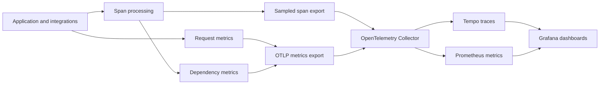

# Architecture

## Responsibilities

`tp_trace` is a Python OpenTelemetry SDK distribution with library integrations and application metrics. It instruments application work, enriches spans, and exports OTLP/HTTP to a Collector. Storage and dashboards run outside the application.

The package targets Python 3.8 or later. The currently declared Django integration minimum is 4.2; lowering that minimum requires separate compatibility validation.

## Telemetry Flow

## Initialization and Ownership

[`init()`](../src/tp_trace/__init__.py) resolves configuration, creates a tracer provider and resource, registers span processors, installs the global propagator, and applies enabled integrations. Repeated calls return the active provider rather than rebuilding configuration. Initialization must happen in each application process; the sample Gunicorn configuration starts the application without preloading it in the master.

The SDK installs a global tracer provider. An application already managing OpenTelemetry providers needs an explicit integration decision; calling two bootstraps is not a supported way to compose ownership. Exit handling attempts to shut down owned tracing and metrics providers.

## Instrumentation and Safety

The integration manager discovers installed libraries and applies enabled instrumentation. Django startup hooks allow deferred patching until its application registry is ready. Wrappers enrich framework and dependency operations, while context-local state carries route, view, and request tags.

Telemetry failures must preserve application call count, arguments, return values, and original exceptions. [`safety.py`](../src/tp_trace/safety.py) supplies guarded telemetry helpers; application execution belongs outside telemetry retry or fallback paths. Exporters also isolate failures. This is a design contract, not a delivery guarantee.

## Sampling and Metrics

The sampler is parent-aware. Root operations use ignore patterns, endpoint rules, and the global sampling rate. Rejected ratio decisions use recording-only spans so dependency metrics can still be computed. Explicitly ignored operations can be dropped entirely. Remote parent sampling decisions are respected after ignore handling.

`SampledOnlySpanProcessor` forwards only sampled spans to the trace export processor. The default trace batch queue holds up to 2,048 spans, exports up to 256 per batch, and uses a 1,000 ms schedule delay. Sampling reduces serialization and trace traffic but does not eliminate instrumentation or recording overhead.

Django request completion records native RED metrics independently of trace export. `RedSpanProcessor` records eligible dependency spans and excludes internal framework spans. Consequently, request counts and dependency counts represent different operations; they are not interchangeable. Metrics are still subject to disabled instrumentation, recording limits, export failures, and shutdown loss.

## Metric Compatibility and Cardinality

The SDK records `calls_total`, `duration_milliseconds`, and `apm_repeated_query_affected_requests_total`. Duration observations use milliseconds with explicit boundaries at 5, 25, 100, 250, 500, 1,000, 2,500, and 5,000 ms. Prometheus exposes the histogram as bucket, sum, and count series.

Identity dimensions include `project_name` and `cluster_name`; service and operation dimensions include `normalized_service` and `normalized_operation`. Request metrics retain route information. Dependency aggregation avoids copying the request route into every dependency series. Span attributes and Prometheus label spellings can differ because dots are normalized on ingestion.

Metric attribute admission is bounded and excess detail can collapse into `__other__` series. This does not make arbitrary tags safe: project counts, workers, tenants, and labels still multiply storage and export costs. Query text and request IDs belong outside metric labels. Changes to names, labels, histogram units, or operation normalization must be checked against the canonical dashboards in [`grafana/`](../grafana/).

## Multiple Workers and Temporality

Each worker has its own meter provider. A datapoint `worker_id` distinguishes independent writers. The owned counter and histogram exporter defaults to delta temporality unless `OTEL_EXPORTER_OTLP_METRICS_TEMPORALITY_PREFERENCE` is explicitly set. The Collector converts delta data to cumulative data before remote-writing it to Prometheus.

Collector resource cleanup removes ephemeral resource attributes, while preserving datapoint worker identity. Removing that identity prematurely can merge independent writers. Delta conversion also maintains bounded Collector state, so process churn and stream limits matter operationally.

## Local and Production Boundaries

| Concern | Local | Production/deployment |
|---|---|---|
| Stack | `dev/docker-compose.yml` | Tempo Compose in `setup/`; Collector Ansible in `ansible/` |
| Collector config | `config/otel-collector.yaml` | Ansible copies `config/otel-collector.yaml` |
| Endpoints | Compose service names | Inventory and group variables |
| Access | Development ports and anonymous Grafana | Host deployment and firewall rules |
| Data | Development named volumes | Deployment-specific persistent storage |

Collector and Tempo configuration now share canonical files under `config/`. Environment values select addresses, bindings, and identity; Collector tuning defaults are shared. Existing explicit Ansible overrides remain supported. Deployment orchestration and access controls remain separate. See [shared configuration](06-environments.md). The repository's deployment Compose currently runs Tempo only; it is not a complete production observability stack.

## Data Exposure and Delivery Limits

The PostgreSQL integration applies the SQL sanitizer before exporting query attributes. Redis endpoint and command details are exposed by default; URL query mode also defaults to exposure. Masking and query controls are listed in the [configuration reference](05-configuration.md). Static tags propagate widely and should contain bounded, non-sensitive values.

Bounded queues, memory limits, sampling, and network failures can lose telemetry. Collector readiness and successful application responses do not prove storage ingestion. Live verification must inspect a stored trace, increasing metric counters, and dashboard queries.
